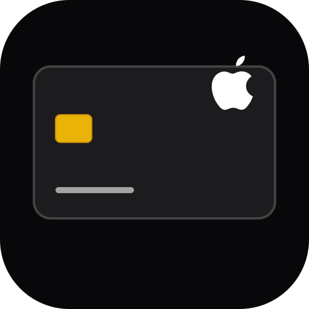

# 💳 Apple Pay Card Studio (Yosfy)

A web studio for designing custom Apple Pay & Apple Wallet cards with realistic 3D tilt, holographic titanium sheen, Apple Wallet live mockups, and Retina card art / PassKit (.pkpass) exports.



---

## ✨ Features

- **Interactive 3D Card View**: Dynamic gyroscope tilt & mouse-follow perspective, specular reflection, and holographic brushed-titanium effect.
- **Apple Wallet Mockups**: Live preview on iPhone Wallet lock screen & Apple Watch Ultra interface.
- **Full Card Customization**:
  - Card networks: Visa, Mastercard, American Express, Apple Card, Discover.
  - Finishes: Matte, Gloss, Holographic, Titanium, Frosted Glass, Carbon Fiber, Velvet Gold.
  - Dual EMV Chip styles, contactless NFC indicators, embossed card numbers, and custom cardholder names.
  - Custom logo upload and brand color picker.
- **Export Capabilities**:
  - High-res PNG card art (1x, 2x, 3x Retina).
  - PassKit (`.pkpass`) package generator for Apple Wallet.
  - JSON preset import & export for sharing designs.
- **PWA Ready**: Offline capable and installable to your home screen on iOS and Android.

---

## 🚀 Getting Started

### Prerequisites

- Node.js (v18+ recommended)
- npm or yarn

### Installation

```bash
# Clone repository
git clone https://github.com/tamimbadawi/yosfy-card-app.git
cd yosfy-card-app

# Install dependencies
npm install

# Start local development server
npm run dev
```

### Production Build

```bash
npm run build
npm run preview
```

---

## 🛠️ Tech Stack

- **Framework**: React 19 + Vite
- **Styling**: Tailwind CSS + Custom CSS 3D Transforms
- **Icons**: Lucide React
- **PWA**: vite-plugin-pwa
- **Utilities**: `jszip`, `file-saver`, `html-to-image`, `canvas-confetti`

---

## 📄 License

MIT License. Designed with care.
